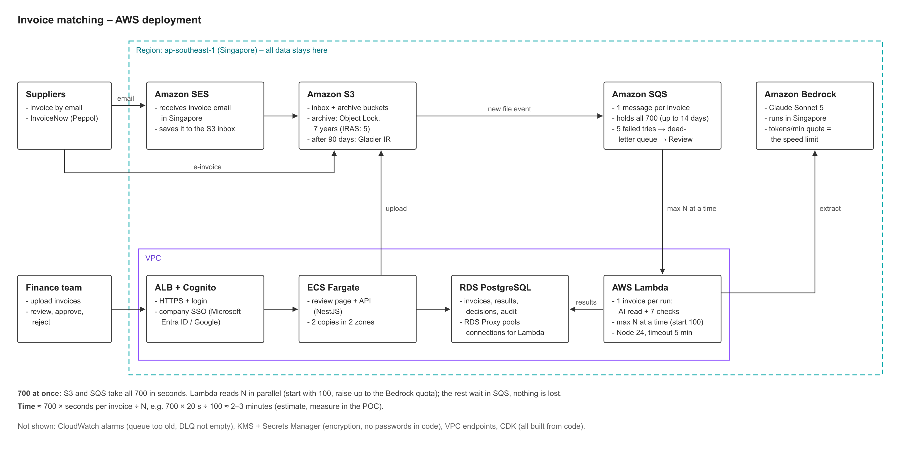

# Infrastructure on AWS (Singapore, `ap-southeast-1`)

> **Accept all 700 at once. Read as many at once as the AI allows. Never lose one.**
>
> **S3 keeps it · SQS holds it · Lambda reads it · Bedrock understands it · Postgres remembers it · Fargate shows it**



## The picture

```
 Email ──► SES ──┐
 Upload ─────────┼──► S3 (invoices) ──event──► SQS queue ──► Lambda readers ──► Bedrock (Claude)
 InvoiceNow ─────┘          │                     │          N at the same time        │
                            │                     └─ failed 5× ─► DLQ ─► "Review"       │
                            ▼                                                         ▼
 Finance ──► ALB + login ──► Fargate: review page + API ◄──────────► RDS PostgreSQL (via RDS Proxy)
             (Cognito/SSO)
```

## Services: what and why

| Service | Job | Why this one |
|---|---|---|
| **S3** | Keeps every invoice file, 7 years | Cheap and very durable. **Object Lock** stops anyone deleting files (IRAS requires 5 years; 7 gives a margin) |
| **SES** | Invoice email inbox | Receives email **in Singapore** and drops it into S3 |
| **SQS** (+ dead-letter queue) | The queue | Takes 700 messages in seconds and keeps them up to 14 days. Retries are built in. A message that fails 5× goes to the DLQ, which we mark Review |
| **Lambda** (Node 24, container image) | Readers: AI read + 7 checks | Starts from 0 and scales to hundreds in about a minute. **Maximum concurrency** caps it at what the AI allows; the rest wait safely in SQS. Pay per invoice |
| **Amazon Bedrock** | Claude reads the invoice | AWS runs it inside our account rules (IAM, no API key). **Claude Sonnet 5 runs inside Singapore** |
| **RDS PostgreSQL + RDS Proxy** | Invoices, results, decisions, audit | Proper database with point-in-time backup. The proxy stops hundreds of Lambdas running out of database connections |
| **ECS Fargate + ALB** | Review page + API (the NestJS app) | Always on, no servers to patch, 2 copies across 2 zones. ALB does the login |
| **Cognito** | Login | Connects to company login (Microsoft Entra ID or Google Workspace) |
| **KMS · Secrets Manager** | Encryption and secrets | Files and database encrypted. No passwords in code |
| **CloudWatch** | Alarms | Queue too old, DLQ not empty, errors |
| **VPC endpoints** | Private network paths | S3 and SQS traffic never touches the internet (Bedrock too, once its endpoint is confirmed in Singapore). The S3 endpoint is free |
| **CDK (TypeScript)** | Builds all of the above from code | Same language as the app, reviewable, repeatable |

## 700 invoices at the same time

1. **Arrive:** 700 files land in S3, and S3 puts 700 messages in SQS within seconds. Nothing waits on the AI.
2. **Fan out:** Lambda starts readers from the queue, **1 invoice per reader**, ramping up to the cap within about a minute.
3. **Cap:** maximum concurrency (e.g. **100**) = what the Bedrock quota allows. Invoice 101 onward waits in SQS. It isn't throttled or lost.
4. **Busy:** if Bedrock says "too many requests", the message reappears after a pause and is retried. After 5 tries it goes to the DLQ → Review.
5. **Done:** each reader writes its result to Postgres, and the page shows it right away.

> **Time ≈ 700 × seconds per invoice ÷ readers at once.**
> Example: 20 s × 700 ÷ 100 ≈ **2–3 minutes**. This is an estimate: measure it in the POC.

| Setting | Value | Why |
|---|---|---|
| Lambda maximum concurrency (SQS trigger) | 100 to start (2–1,000 allowed) | Raise until Bedrock starts saying "busy" |
| Lambda timeout | 5 min | One invoice takes seconds; this leaves room |
| SQS visibility timeout | 30 min (≥ 6 × Lambda timeout) | AWS recommendation: leaves room for retries when Lambda is throttled |
| SQS → DLQ after | 5 tries | AWS recommendation |
| Batch size | 1 | Each invoice succeeds or fails on its own |
| Lambda account limit | Ask AWS for ≥ 1,000 | New accounts start lower |
| Bedrock tokens per minute | Ask AWS to raise it before go-live | The real limit on speed |

## Which Claude on AWS?

| Option | Where the AI runs | Use it when |
|---|---|---|
| **Bedrock, Claude Sonnet 5, in-Region** ✅ | **Singapore only** | **Default.** Invoice data must stay in Singapore (PDPA) |
| Bedrock, Claude Sonnet 5.5 / Opus 5.5, "Global" | Any AWS region worldwide | Newest models are needed, and data leaving Singapore is acceptable |
| Claude Platform on AWS | Run by Anthropic; AI runs "global" or "us" only | Not for this workload: data leaves Singapore, and Anthropic (not AWS) processes it |

On Bedrock, AWS is the data processor and Anthropic keeps no inputs or outputs.

## Option: keep the AI in Singapore with our own model

**Amazon SageMaker AI asynchronous inference**, `ml.g5.xlarge` (A10G GPU, about US$1.97/hour), running vLLM + a vision model.
- **Scales to zero** when idle, and holds its own queue of up to 6 hours, so it suits a month-end burst.
- The usual EC2 GPU servers (g5, g6, g6e) **aren't offered in Singapore**. That's why it's SageMaker.
- A 12B model at full precision needs 40 GB+, so use a quantized version on a 24 GB A10G.
- Speed on invoices is **unknown**: benchmark on your own invoices first.

## Security and retention

- **Everything in `ap-southeast-1`**, including email (SES) and the AI (Bedrock in-Region).
- **Two buckets:** an *inbox* bucket (SES can't write to a locked bucket), then an *archive* bucket with **Object Lock (compliance mode, 7 years)**. After 90 days, files of 128 KB or more move to **Glacier Instant Retrieval**: cheaper, still opens in milliseconds (smaller ones stay in Standard by default).
- **Private subnets only.** Login at the ALB. The app checks the signed login token.
- **The queue is "at least once":** a message can arrive twice. The duplicate check (file fingerprint + supplier + invoice no.) makes that harmless.

## Before go-live

1. Ask AWS to raise the **Bedrock tokens-per-minute** and **Lambda concurrency** quotas.
2. Check that the **Bedrock VPC endpoint** exists in Singapore (`aws ec2 describe-vpc-endpoint-services`).
3. Test Object Lock in *governance* mode first: *compliance* mode can never be undone.
4. Load test: 700 real-size invoices at once, then measure the time and the AI cost per invoice.

## Code changes from today's version

| Today | On AWS |
|---|---|
| Queue inside the app (`InvoiceStore`) | SQS + a Lambda handler calling the same `MatchingService` |
| `store.json` | Postgres table (same states: QUEUED → READING → DONE) |
| Claude API client | Bedrock client, model `anthropic.claude-sonnet-5` (Bedrock has no server-side fallback, so retry on the app side) |
| Files on disk | S3 |

Schema, readers and checks (`src/invoice-matching/`) stay the same.
