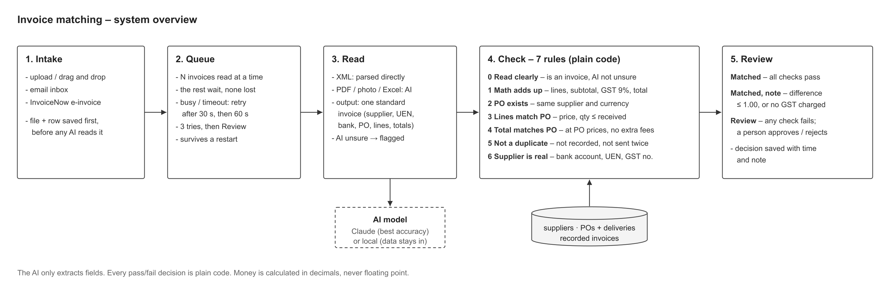

# System Design: Invoice Matching

> **Any invoice in → one standard invoice → 7 checks → people only see the problems.**
>
> **AI reads. Rules decide.**



## 5 steps: IN → QUEUE → READ → CHECK → REVIEW

```
 Upload · Email · InvoiceNow
          │
   1  IN       save the file, add a row                  instant, even 700 at once
          │
   2  QUEUE    wait your turn · N read at a time          busy? wait, try again (3 tries in all)
          │
   3  READ     XML ────────────── read directly (no AI)
               PDF/photo/Excel ── AI: Claude or a local model
                                  → OUR STANDARD INVOICE
          │
   4  CHECK    7 checks  ◄── supplier list · PO · delivery · recorded invoices
          │
   5  REVIEW   ✅ Matched → pay      ⚠️ Note → pay, see note      ❌ Review → a person decides
```

| Step | Job | In the code |
|---|---|---|
| 1 IN | Save the file and its row first, so nothing is lost | `InvoicesController`, `InvoiceStore.add` |
| 2 QUEUE | Let 700 arrive at once, but read only as many as the AI can handle | `InvoiceStore` (on AWS: SQS) |
| 3 READ | Turn any format into the same standard invoice | `ReaderService`, `ClaudeExtractor`, `LocalLlmExtractor` |
| 4 CHECK | Plain-code rules, each with a written reason | `CheckerService` |
| 5 REVIEW | Every invoice is listed with its result; people check the problems and approve or reject | review page (`public/`) |

## The 7 checks

| # | Check | Fails when |
|---|---|---|
| 0 | Read clearly | not an invoice, AI unsure of a field, or a page not read |
| 1 | Math adds up | qty × price, subtotal, GST 9% or total don't add up |
| 2 | PO exists | no PO, wrong supplier, or different currency |
| 3 | Lines match PO | price ≠ PO, or more invoiced than **received** |
| 4 | Total matches PO | subtotal before GST ≠ qty × PO prices, or **extra fees** not on the PO |
| 5 | Not a duplicate | already recorded in accounting, or the same invoice sent twice |
| 6 | Supplier is real | **bank account changed**, UEN or GST number differs |

Any ✗ → **Review**. A difference of ≤ 1.00 on any checked amount (rounding), or no GST from a GST-registered supplier → **Matched with a note**.

## 5 rules that never change

1. **AI reads, rules decide.** The AI only copies. Code decides pass or fail.
2. **Save first, read later.** Every invoice (file + row) is stored before any AI touches it.
3. **Nothing silent.** Unsure, unread or cut off → Review, never "matched".
4. **Money is exact.** Decimals only, never floating-point numbers.
5. **The later copy is the duplicate.** An identical file is flagged at once. A copy in another format (e.g. PDF + XML) is flagged once both are read.

## Two AIs, one switch

| | **Claude** (`AI_PROVIDER=claude`) | **Local model** (`AI_PROVIDER=local`) |
|---|---|---|
| Accuracy | Best | Misreads small print more often. The checks catch most of it |
| Invoice data | Goes to Anthropic (or AWS) | Stays in your network |
| Speed | Not measured yet | 15–18 s per invoice (Mac M5, `gemma4:12b`) |
| PDFs | Read directly | Pages become text or images first |

Both produce the **same standard invoice**, so steps 4 and 5 never change.

## Why 700 at once works

- **Arriving is cheap:** saving and queuing 700 files takes about a second.
- **Reading is the only slow part, and it's capped:** at most N at a time. The rest wait safely.
- **Checks are instant:** milliseconds each, and can be re-run any time without AI.

> **Time for 700 = 700 × seconds per invoice ÷ invoices read at the same time**

Proven on this Mac:
- **XML:** 700 in one upload were checked in **2 seconds**.
- **AI queue:** 700 went through with **8 at a time**. All 70 "busy" errors were retried, and all 700 finished.

How this runs on AWS: [INFRASTRUCTURE-AWS.md](INFRASTRUCTURE-AWS.md).
